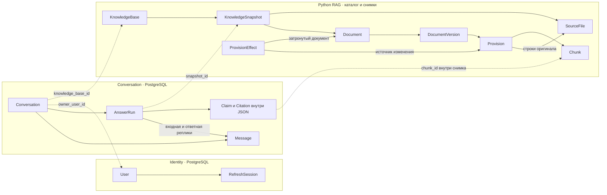

# JURION. Сущности для ревью MVP

[Актуальное задание](tasks/final.md) · [API фронтенда](api.md)

## Что предлагаю оставить

| Где живут данные | Сущности | Зачем |
| --- | --- | --- |
| PostgreSQL · Identity | `User`, `RefreshSession` | Пользователь, роль и цикл обновления токенов. Реализация — в [Identity](../services/identity_service), публичные поля — в [API](api.md) |
| PostgreSQL · Conversation | `Conversation`, `Message`, `AnswerRun` | История чата, ожидание ответа, восстановление после обрыва и повтор |
| Каталог и снимок · Python RAG | `KnowledgeBase`, `KnowledgeSnapshot`, `SourceFile`, `Document`, `DocumentVersion`, `Provision`, `ProvisionEffect`, `Chunk` | Поиск в исходниках, редакции, применимость изменений и открытие точной цитаты |
| Внутри `AnswerRun.answer` | `Claim` и `Citation` | Выводы и ссылки читаются вместе с ответом. В MVP достаточно вложенного JSON |
| В памяти на время запроса | `QueryContext`, `Evidence`, `Draft` | Промежуточные данные для поиска и проверки |

`id` — непрозрачный идентификатор. В PostgreSQL предлагаю UUID для собственных ID чата. Идентификаторы корпуса задаёт Python. `date` — календарная дата, `timestamp` — время в UTC. Знак `?` указывает, что поле может быть пустым.



Пунктир показывает идентификаторы, которые пересекают границу сервисов. Владелец берётся из проверенного контекста Gateway. База и источники разрешаются через Legal QA. Сервисы общаются по gRPC.

## Conversation Service

### Conversation

Один чат по одной базе. При отправке или завершении ответа Go коротко блокирует строку диалога, чтобы согласованно записать следующий номер сообщения и состояние попытки.

| Поле | Тип | Зачем |
| --- | --- | --- |
| `id` | UUID | ID в маршрутах API |
| `owner_user_id` | UUID · Identity User | Сравнивается с ID из проверенного JWT. Связь между сервисами |
| `knowledge_base_id` | string | По какой базе отвечает этот чат |
| `title` | string | Заголовок в списке чатов |
| `latest_run_id?` | UUID → AnswerRun | Возобновление ожидания и проверка, что повторяют последнюю попытку |
| `created_at` | timestamp | Дата создания |
| `updated_at` | timestamp | Сортировка списка по последней активности |

### Message

Одна пользовательская или финальная реплика ассистента. История для RAG собирается по `conversation_id` и `seq` до исходного вопроса включительно.

| Поле | Тип | Зачем |
| --- | --- | --- |
| `id` | UUID | Постоянный ID для истории и объединения сообщений на фронте |
| `conversation_id` | UUID → Conversation | В каком чате находится реплика |
| `seq` | integer | Порядок в чате и пагинация |
| `role` | enum | `user` или `assistant` |
| `text` | text | Текст пользователя или проверенный текст ответа |
| `created_at` | timestamp | Время отправки или сохранения ответа |

### AnswerRun

Одна попытка обработать конкретный вопрос. При техническом повторе создаём новую попытку с тем же `user_message_id`. Один запрос пользователя может иметь несколько попыток и один успешно сохранённый ответ.

| Поле | Тип | Зачем |
| --- | --- | --- |
| `id` | UUID | ID для `GET /runs/{id}` и трассировки вызова RAG |
| `conversation_id` | UUID → Conversation | Проверка доступа и правило одной активной попытки на чат |
| `user_message_id` | UUID → Message | Какой вопрос обрабатываем |
| `assistant_message_id?` | UUID → Message | Какая реплика получилась после успешного завершения |
| `retry_of_run_id?` | UUID → AnswerRun | Исходная попытка при явном повторе |
| `idempotency_key` | UUID | Повтор HTTP-запроса после обрыва |
| `request_hash` | bytes | Сравнение запросов с тем же ключом. Хешируем тип операции, входные данные и ID исходной попытки при повторе |
| `as_of_date?` | date | Дата, явно переданная фронтом. Повтор использует то же значение |
| `state` | enum | `running`, `completed` или `failed`. `running` включает ожидание обработчика |
| `snapshot_id?` | string | Снимок, который вернул RAG. Заполнен у готового ответа |
| `answer?` | JSON | `outcome`, `claims[]`, `missing_information[]`, `clarification_question` |
| `error?` | JSON | `code`, `message`, `retryable` при техническом сбое |
| `provider?`, `model?` | string | Какой провайдер и модель участвовали в готовом ответе. Могут отсутствовать при ответе по правилам |
| `created_at` | timestamp | Когда приняли попытку |
| `claimed_at?` | timestamp | Когда фоновый обработчик забрал попытку |
| `deadline_at` | timestamp | Крайний срок всей попытки, включая ожидание обработчика |
| `finished_at?` | timestamp | Когда получен результат или зафиксирован сбой |

Проверки для реализации:

- `UNIQUE (conversation_id, seq)` для `Message`. Следующий `seq` вычисляем под блокировкой строки диалога.
- `UNIQUE (conversation_id, idempotency_key)` для `AnswerRun`. Повтор с тем же ключом сначала проверяет хеш запроса и находит исходную попытку.
- Один `running` на чат. Для защиты от гонок используем частичный уникальный индекс по `conversation_id` для строк со `state = 'running'`. [Документация PostgreSQL](https://www.postgresql.org/docs/17/indexes-partial.html)
- `user_message_id` ссылается на реплику пользователя из того же диалога. `assistant_message_id` ссылается на ответ в том же диалоге. Состояние `completed` требует ответ, `snapshot_id` и готовую реплику. Состояние `failed` требует ошибку.
- Завершение попытки и создание ответной реплики фиксируются одной транзакцией.

### Claim и Citation

Это структуры внутри JSON, которые соответствуют [API ответа](api.md#готовый-ответ).

| Структура | Поля | Когда используется |
| --- | --- | --- |
| `Claim` | `id: string`, `text: string`, `citations: Citation[]` | Один подтверждённый вывод. Если ответ опирается на несколько пунктов, вывод может иметь несколько цитат |
| `Citation` | `chunk_id: string`, `label: string`, `quote: string` | Ссылка на точное место и текст для отображения. `snapshot_id` берём из `AnswerRun` |

Отдельные таблицы для этих структур понадобятся, если появятся оценка конкретных выводов, поиск по цитатам во всех ответах или отдельные права на редактирование. Пока основной путь чтения загружает готовый ответ целиком.

## Python RAG

Каталог хранит указатель на активный снимок. Внутри снимка находятся метаданные, поисковый индекс и ссылки на сохранённые оригиналы. В MVP это записи манифеста и файлового индекса. Один и тот же формат может читать веб-сервис и скрипт сабмита.

### KnowledgeBase и KnowledgeSnapshot

`KnowledgeBase` — набор документов. `KnowledgeSnapshot` — его неизменяемая публикация. Импорт переключает активный снимок после проверки. RAG выбирает его при начале запроса, а при открытии цитаты читает снимок, закреплённый за ответом.

| Сущность | Поле | Тип | Зачем |
| --- | --- | --- | --- |
| KnowledgeBase | `id`, `title` | string | ID и название в списке баз |
| KnowledgeBase | `active_snapshot_id` | string → KnowledgeSnapshot | Публикация для новых запросов |
| KnowledgeSnapshot | `id`, `knowledge_base_id` | string | ID снимка и его базы |
| KnowledgeSnapshot | `created_at` | timestamp | Дата публикации |
| KnowledgeSnapshot | `schema_version` | integer | Версия формата манифеста |
| KnowledgeSnapshot | `manifest_sha256`, `index_ref` | string | Проверка манифеста и адрес поискового индекса |

### SourceFile

Создаём при импорте. Читаем при извлечении дословной цитаты и выдаче оригинала.

| Поле | Тип | Зачем |
| --- | --- | --- |
| `id` | string | Ссылка на файл внутри снимка |
| `original_name` | string | Имя для скачивания и показа в интерфейсе |
| `storage_key` | string | Адрес сохранённого оригинала |
| `sha256` | string | Проверка исходника при повторном импорте |
| `media_type` | string | Тип ответа. В текущем корпусе `text/plain` |

### Document и DocumentVersion

`Document` объединяет редакции одной карточки. `DocumentVersion` указывает на конкретную редакцию или выгрузку. Читаем карточку при определении документа, а редакцию при выборе нормы на дату.

| Сущность | Поле | Тип | Зачем |
| --- | --- | --- | --- |
| Document | `id`, `title`, `number?` | string | Поиск по названию и номеру |
| Document | `kind` | enum | Закон, договор, регламент, допсоглашение, письмо или записка |
| Document | `aliases` | string[] | Проверенные варианты названия, номера и контрагента |
| DocumentVersion | `id`, `document_id` | string | Привязка к карточке документа |
| DocumentVersion | `label?` | string | Отображаемое название редакции |
| DocumentVersion | `effective_from?`, `effective_to?` | date | Известные границы интервала действия `[from, to)` |
| DocumentVersion | `observed_on?` | date | Дата выгрузки |
| DocumentVersion | `coverage_kind` | enum | Редакция документа компании или выгрузка отдельных статей |
| DocumentVersion | `validity_status` | enum | Подтверждённый период, наблюдение на дату выгрузки или неразрешённая редакция |

Дата выгрузки закона 10.10.2026 фиксирует содержимое корпуса на эту дату. Она не задаёт начало действия текста. Неизвестную дату начала нельзя читать как бессрочное действие в прошлом. Похожие имена в `aliases` могут вести к нескольким документам, тогда сервис уточняет, какой из них имелся в виду.

### Provision и Chunk

`Provision` — пункт, часть или абзац. `Chunk` — единица поиска и адрес цитаты. Для короткого пункта один фрагмент покрывает весь текст, а длинный пункт можно разделить. Один документ закона может ссылаться на несколько файлов через `Provision.source_file_id`.

| Сущность | Поле | Тип | Зачем |
| --- | --- | --- | --- |
| Provision | `id`, `document_version_id` | string | Положение в конкретной редакции |
| Provision | `provision_key`, `label?` | string | Сопоставление пункта между редакциями и подпись для интерфейса |
| Provision | `source_file_id` | string → SourceFile | Исходник текста |
| Provision | `text_start`, `text_end` | integer | Диапазон текста положения |
| Provision | `content_kind` | enum | Текст положения, редакционная справка или анонс изменения |
| Chunk | `id`, `provision_id` | string | Адрес фрагмента в снимке и связь с положением |
| Chunk | `text_start`, `text_end` | integer | Диапазон фрагмента в том же исходнике |
| Chunk | `line_start`, `line_end` | integer | Номера строк в оригинале для интерфейса |

Текстовые диапазоны задаются как `[start, end)` с нуля по символам декодированного UTF-8 после нормализации переводов строк. Номера строк считаются с единицы, обе границы включены. У А-08/2024 `chunk_a08_3_1` указывает на строку 14. Пара `snapshot_id + chunk_id` остаётся действительной после публикации нового снимка.

### ProvisionEffect

Создаём при импорте допсоглашений и дополняющих писем. Поиск читает эти правила, когда сравнивает условия изменения с фактами вопроса.

| Поле | Тип | Зачем |
| --- | --- | --- |
| `id` | string | ID проверенного правила |
| `source_provision_id` | string → Provision | Откуда взято условие |
| `target_document_id`, `target_provision_key?` | string | Какой документ или пункт меняется |
| `replacement_provision_id?` | string → Provision | Текст замены или дополнительного требования, если его нужно адресовать отдельно |
| `kind` | enum | `replace` или `supplement` |
| `effective_from?`, `effective_to?` | date | Когда само изменение действует |
| `conditions` | Condition[] | К каким ситуациям оно применяется |
| `resolution_status` | enum | `reviewed` или `unresolved` |

### Пример условия допсоглашения

Для П-17/2024 допсоглашение подписано **3 сентября 2024 года**. Оно вступает в силу при подписании, но новый адрес применяется к партиям, спецификации на которые подписаны **после 1 октября**.

```json
{
  "id": "effect_p17_address",
  "source_provision_id": "prov_amendment_condition",
  "target_document_id": "doc_p17",
  "target_provision_key": "3.2",
  "replacement_provision_id": "prov_amendment_new_address",
  "kind": "replace",
  "effective_from": "2024-09-03",
  "effective_to": null,
  "conditions": [
    {
      "fact_key": "specification_signed_on",
      "operator": "gt",
      "value": "2024-10-01"
    }
  ],
  "resolution_status": "reviewed"
}
```

`Condition` состоит из `fact_key`, `operator` и типизированного `value`. Для текущих примеров нужны сравнения даты и проверка признака иностранного контрагента. Если факт отсутствует или правило требует проверки, применимость считается неизвестной. При дате спецификации 1 октября правило замены ещё не применяется, при дате 2 октября применяется. Для письма К‑12 `kind = supplement` добавляет требование к действующему пункту. В таком ответе пригодятся оба источника.

## Что передаётся между функциями

| Структура в памяти | Основные поля | Путь |
| --- | --- | --- |
| `QueryContext` | `question`, `as_of_date?`, `candidate_document_ids[]`, `facts[]` | Контекст передаётся из разбора запроса в поиск. У факта есть ключ, значение и ссылка на реплику или явный параметр |
| `Evidence` | `chunk_id`, `version_id`, `text`, `applicability` | Результаты поиска передаются в генерацию и проверку. Применимость бывает подтверждённой, исключённой или неизвестной |
| `Draft` | `claims[]` с текстом и `candidate_chunk_ids[]`, `missing_information[]` | Черновик от модели передаётся в проверку. Точные цитаты собираются из исходника |

## Что оставить на потом

| Возможное расширение | Когда понадобится |
| --- | --- |
| `Workspace`, `Membership` | Когда понадобятся отдельные организации и роли внутри них. В MVP пользователи и роли уже принадлежат Identity |
| `ImportJob` | Когда пользователь сможет сам загрузить документы и наблюдать статус обработки. Сейчас импорт запускает команда через CLI |
| `Feedback` | Когда появится оценка ответов в интерфейсе. Можно связать с `AnswerRun.id` |
| `GenerationAttempt` | Когда понадобится отдельный аудит каждого повтора модели и переключения провайдера |
| Таблицы `Claim`, `Citation` | Когда понадобятся выборки и операции по отдельным выводам |
| Отдельная сущность контрагента | Когда контрагент станет объектом интерфейса и понадобится каталог. Пока хватит проверенных алиасов документа |

При ревью стоит проверить, кто записывает поле, на каком шаге оно читается и какой сценарий от него зависит. [Движение запроса](request-flow.md) описывает запись и обработку вопроса. [Итоговое задание F-01](tasks/final.md) фиксирует оставшиеся требования к контексту, снимкам, доказательствам и проверке ответа.
