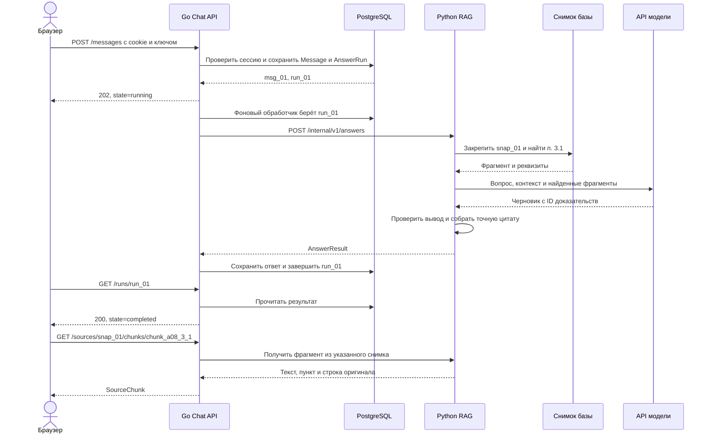

# JURION. Путь запроса от JSON до ответа

[Внешний API фронтенда](api.md) · [Сущности и поля](entities.md)

> Этот файл сохраняет первоначальный разбор варианта из двух сервисов. Актуальный путь начинается с Gateway, сессиями владеет Identity, внутренние вызовы идут по gRPC. Реализацию вести по [схеме четырёх сервисов и заданиям](tasks/README.md).

Ниже предлагаемый вариант с двумя сервисами. Фрагменты кода показывают границы и порядок вызовов. В репозитории пока есть контракт фронтенда и инфраструктурный каркас. Реализацию обработчиков предстоит добавить.

## Кто за что отвечает

| Компонент | Что делает | Чем владеет |
| --- | --- | --- |
| `chat-api` · Go | Принимает HTTP от браузера, проверяет сессию, сохраняет вопрос, запускает обработку и выдаёт результат | PostgreSQL с сессиями, диалогами, сообщениями и попытками ответа |
| `rag` · Python | Выбирает снимок базы, ищет положения, применяет редакции и условия, вызывает модель и проверяет основания | Индекс, оригиналы документов, каталог снимков |
| `rag import` · Python CLI | Извлекает положения и строит снимок базы | Записывает и публикует снимки, которые читает `rag` |
| API моделей | Генерирует черновик. По конфигурации строит эмбеддинги или реранжирует фрагменты | Вход модели и её ответ на текущий вызов |

Go и Python общаются по внутреннему HTTP/JSON. Go читает документы через `rag`. Python получает только историю нужного диалога и параметры запроса. Фоновый обработчик живёт в `chat-api`, поэтому запускать отдельный брокер сообщений для MVP не требуется.

## Пример входа

Пользователь уже открыл диалог `conv_01` по базе `kb_psb`. Фронтенд отправляет запрос по [согласованному контракту](api.md#отправка-сообщения).

```http
POST /api/v1/conversations/conv_01/messages
Content-Type: application/json
Idempotency-Key: e8bd1e40-d076-46d0-8f53-4abb605ab184
```

```json
{
  "text": "Какая арендная плата по договору с ООО «Северный Склад»?"
}
```



## 1. HTTP-обработчик в Go принимает JSON

Первым запрос получает `ChatHandler.SendMessage`. Он проверяет cookie, извлекает `conversation_id` из маршрута и десериализует разрешённые поля тела. Доменная операция начинается в `ChatService.AcceptMessage`.

```go
type SendMessageInput struct {
    Text     string  `json:"text"`
    AsOfDate *string `json:"as_of_date,omitempty"`
}

func registerRoutes(mux *http.ServeMux, handler *ChatHandler) {
    mux.HandleFunc(
        "POST /api/v1/conversations/{conversation_id}/messages",
        handler.SendMessage,
    )
}

func (h *ChatHandler) SendMessage(w http.ResponseWriter, r *http.Request) {
    sessionID, input, key, err := h.readSendRequest(r)
    if err != nil {
        h.writeError(w, err)
        return
    }

    run, err := h.chat.AcceptMessage(
        r.Context(), sessionID, r.PathValue("conversation_id"), key, input,
    )
    if err != nil {
        h.writeError(w, err)
        return
    }

    h.writeRun(w, run) // 202 для running, 200 для completed.
}
```

`readSendRequest` валидирует длину текста, дату и формат ключа. Роль `user` задаёт сервер. Историю сервер загружает из PostgreSQL по ID диалога. Пример маршрута использует [Go net/http ServeMux](https://pkg.go.dev/net/http#ServeMux).

В `AcceptMessage` открываем короткую транзакцию:

1. Загружаем принадлежащий сессии `Conversation` и блокируем его строку на время записи.
2. Проверяем `Idempotency-Key`. При том же запросе возвращаем существующий `AnswerRun`. При изменении тела с тем же ключом отдаём `409 IDEMPOTENCY_CONFLICT`.
3. Проверяем, есть ли активная попытка с другим ключом. Если есть, возвращаем `409 RUN_IN_PROGRESS`.
4. Создаём `Message` с ролью `user` и следующим `seq`. Создаём `AnswerRun` со статусом `running` и сроком обработки. Обновляем `Conversation.latest_run_id`.
5. Фиксируем транзакцию и возвращаем `202`. При повторе с прежним ключом завершённый результат уже может прийти с `200`. Сохранённый технический сбой отображается по правилам `503/504` из [API](api.md#ошибки-api).

Один `AnswerRun` одновременно служит записью состояния и заданием для фонового обработчика. Если браузер оборвёт соединение после коммита, попытка уже сохранена. Повтор исходного POST получит тот же ID сообщения.

## 2. Фоновый обработчик передаёт запрос в Python

Фоновый обработчик Go берёт `running` с пустым `claimed_at` и неистёкшим `deadline_at`. Короткая транзакция резервирует строку и проставляет `claimed_at`. Вызов Python начинается после коммита. При нескольких обработчиках выбор задачи можно делать через `FOR UPDATE SKIP LOCKED`. [Документация PostgreSQL](https://www.postgresql.org/docs/17/sql-select.html#SQL-FOR-UPDATE-SHARE)

```go
func (w *AnswerWorker) Process(ctx context.Context, run AnswerRun) error {
    messages, err := w.chat.HistoryThrough(ctx, run.ConversationID, run.UserMessageID)
    if err != nil {
        return w.chat.Fail(ctx, run.ID, mapError(err))
    }

    callCtx, cancel := context.WithDeadline(ctx, run.DeadlineAt)
    defer cancel()

    result, err := w.rag.Answer(callCtx, NewRagRequest(run, messages))
    if err != nil {
        return w.chat.Fail(ctx, run.ID, mapError(err))
    }

    return w.chat.Complete(ctx, run.ID, result)
}
```

`RagClient.Answer` отправляет `POST /internal/v1/answers`:

```json
{
  "run_id": "run_01",
  "knowledge_base_id": "kb_psb",
  "messages": [
    {
      "role": "user",
      "text": "Какая арендная плата по договору с ООО «Северный Склад»?"
    }
  ],
  "as_of_date": null,
  "deadline_at": "2026-11-10T16:31:05Z"
}
```

`messages` упорядочены от старых к новым и заканчиваются исходной пользовательской репликой. По этому правилу предыдущий ответ может помочь понять фразу «по этому договору». Для юридического вывода всё равно нужны положения из базы.

Успешный ответ RAG содержит `snapshot_id`, `outcome`, `text`, `claims[]`, `missing_information[]`, `clarification_question`, `provider` и `model`. Если модель не вызывалась, `provider` и `model` равны `null`. Каждый вывод содержит `text` и массив `citations` с `chunk_id`, `label` и `quote`. Публичные ID выводов выдаёт Go при сохранении результата. При сетевой ошибке или недоступности модели Go сохраняет техническую ошибку в `AnswerRun`.

## 3. Python находит основания и собирает результат

Веб-обработчик Python и `solution.py` используют одну функцию ядра `answer`. Внутри веб-варианта каталог открывает активный снимок выбранной базы. В сабмите используется снимок, построенный из архива организаторов.

```python
def answer(request, catalog, provider):
    snapshot = catalog.open_active(request.knowledge_base_id)
    query = resolve_context(snapshot, request.messages, request.as_of_date)

    decision = check_request_policy(query)
    if decision is not None:
        return build_policy_result(decision, snapshot.id)

    if query.needs_document_clarification:
        return build_clarification_result(query, snapshot.id)

    evidence = search(snapshot, query)
    if evidence.is_empty:
        return build_missing_result(query, evidence, snapshot.id)

    draft = provider.generate(query, evidence, deadline=request.deadline_at)
    checked = verify(draft, evidence, snapshot, query)
    return build_result(checked, snapshot.id, provider)
```

| Функция | Что читает | Что возвращает |
| --- | --- | --- |
| `catalog.open_active` | `KnowledgeBase` и `KnowledgeSnapshot` | Один неизменяемый снимок на весь вызов |
| `resolve_context` | Реплики, переданную дату и справочник названий при разрешении ссылок на документы | Последний вопрос, кандидаты документов и факты из запроса |
| `search` | `Document`, `DocumentVersion`, `ProvisionEffect`, `Provision` и `Chunk` | Применимые доказательства и известные пробелы, например неизвестную дату спецификации |
| `provider.generate` | Вопрос и отобранные фрагменты с ID | Черновик, где каждый вывод ссылается на выданные фрагменты |
| `verify` | Черновик, выбранные фрагменты и `SourceFile` | Проверенные выводы и извлечённые из источника цитаты |

В примере `search` находит договор А-08/2024 и п. 3.1. `verify` проверяет, что фрагмент относится к выбранному снимку и содержит **450 000 рублей в месяц, включая НДС**. Для сложного вывода проверка включает смысловую поддержку, помимо существования ID. Если подтверждена только часть, `build_result` может вернуть `partially_answered`. Пустая выдача после первого поиска запускает расширение поиска. Вывод о нехватке данных делаем после проверки расширенной выдачи и состава снимка.

Для вопроса по П-17/2024 поиск также читает `ProvisionEffect`. Он сравнивает **дату подписания спецификации** с 1 октября 2024 года. При неизвестной дате вывод остаётся условным. В [модели данных](entities.md#пример-условия-допсоглашения) приведены поля правила.

## 4. Go сохраняет результат и выдаёт его фронту

`ChatService.Complete` в одной транзакции проверяет, что попытка всё ещё `running` и дедлайн не истёк. Затем создаёт `Message` с ролью `assistant` и сохраняет `snapshot_id`, исход, выводы и цитаты в `AnswerRun`. При фиксации статус становится `completed`. Поэтому фронт получает реплику и основания вместе.

| После какого шага | Что лежит в PostgreSQL |
| --- | --- |
| Вопрос принят | `Message(msg_01, user, seq=1)`. `AnswerRun(run_01)` ссылается на `msg_01`, состояние `running` |
| Ответ проверен | Добавлен `Message(msg_02, assistant, seq=2)`. У того же `run_01` состояние `completed`, ссылка на `msg_02` и снимок `snap_01` |
| Пользователь нажал на цитату | Записей в чате не добавляется. RAG читает фрагмент `chunk_a08_3_1` из `snap_01` |

`GET /api/v1/runs/run_01` читает попытку и сообщения из PostgreSQL. Формат результата совпадает с [примером в API](api.md#готовый-ответ). При клике на цитату Go проверяет доступ к базе и передаёт `snapshot_id` и `chunk_id` в `GET /internal/v1/sources/{snapshot_id}/chunks/{chunk_id}`. Python читает закреплённый снимок и формирует `SourceChunk`. Оригинал проходит тем же путём через внутренний маршрут `/internal/v1/sources/{snapshot_id}/files/{file_id}`. ID файлов и фрагментов разрешаются по каталогу снимка.

Если Go или Python перезапустился посреди обработки, записи с истёкшим дедлайном переводятся в `failed`. Поздний ответ не меняет уже завершённую попытку. Пользователь может вызвать `POST /runs/{run_id}/retry`. Go создаёт новый `AnswerRun` для той же исходной реплики. Повтор использует историю до неё и исходную `as_of_date`.

## Где это будет лежать в коде

| Предлагаемый путь | Ответственность |
| --- | --- |
| `services/chat_api/internal/http/chat.go` | HTTP, DTO, cookie, коды ответа |
| `services/chat_api/internal/chat/service.go` | Отправка, история, повтор и сохранение результата |
| `services/chat_api/internal/chat/worker.go` | Выбор сохранённой попытки, вызов RAG и дедлайн |
| `services/chat_api/internal/store/postgres.go` | Транзакции и запросы к PostgreSQL |
| `services/chat_api/internal/ragclient/client.go` | Внутренние HTTP-вызовы и преобразование ошибок |
| `services/rag/app/api.py` | Внутренние маршруты ответа и выдачи источников |
| `services/rag/app/core/answer.py` | Контекст, поиск, генерация и проверка |
| `services/rag/app/corpus/importer.py` | Разбор архива, метаданные редакций и публикация снимка |

`solution.py` читает независимые строки CSV, вызывает ядро напрямую и записывает `submission.csv`. Для архива сдачи необходимые Python-модули размещаются в корне согласно регламенту. Веб-контракт `/api/v1` остаётся общим для обоих вариантов размещения RAG. Если решим начать с одного Python-процесса, внутренний HTTP-вызов заменится прямым вызовом `answer`.
